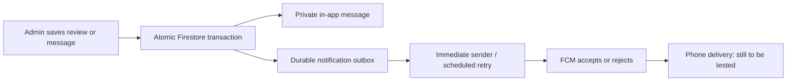

# Report-update push delivery

**Integration-audit follow-up, 2026-10-25:** the
[push investigation](full-app-integration-audit.md) records 12 expected
unauthorized-worker rejections with no retries, a passing nine-check hosted
regression and confirmed synthetic-device cleanup. Test diagnostics now preserve
the first failed check, record cleanup failure separately and retain sanitized
HTTP/network observations. The media phase's original intermittent failure
remains unexplained; current passing requests do not establish its cause.

Updated 2026-10-25. Report-update push is implemented for the isolated **`safepaths-test`** / Supabase proof environment. **APK builds remain on hold at the user's request.** No updated APK was built, installed or distributed. The main Firebase project, billing and existing APKs remain unchanged.

This extends [resident/admin communication](admin-resident-workflow.md). It does not complete the other Spark migrations or the legacy broadcast/weather notification paths.

## What happens after an admin saves

The admin's success acknowledgement means the review/message was saved. Push processing happens afterward. An unavailable sender or failed background-task hook cannot invalidate that saved result. Residents can read the private update in report history even when push fails.

The notification says **“SafePaths report update”** and asks the resident to open report history. Private replies, report descriptions, photos, exact locations and rescue details are not placed in the push payload. Tapping a report notification fetches the current report and its private thread; stale notification text is not used as the current road condition.

FCM acceptance is recorded as `fcm_accepted`, never as confirmed phone delivery or proof that a resident read the update. [Firebase explains this acceptance/delivery distinction](https://firebase.google.com/docs/cloud-messaging/customize-messages/setting-message-lifespan).

## Registration, retries and account changes

- The server owns `push_devices` and `push_token_claims`. Direct client reads/writes are denied, including admin client reads. The sender ignores legacy client-writable profile `fcmTokens`.
- Registrations use a random installation credential and increasing sequence. Transfers on the same installation reject delayed registrations from the previous account. A different installation cannot take another active registration's token. Up to three devices can be active per synthetic account.
- Logout unregisters before Firebase sign-out and deletes the local FCM token where possible. Registration refreshes on token/account changes and notification-permission checks. Foreground display and taps reject a different recipient account; logout clears pending routing data/local notifications.
- Each event has a 90-second lease. The first attempt saves a target/binding snapshot, then rechecks the device before sending. A pending event cannot follow a transferred installation into another account. Disabled/unverified accounts, revoked/stale registrations and changed report ownership are skipped.
- Accepted devices have durable receipts. Ordinary retries send only to remaining devices. Temporary failures use at least one minute of exponential backoff and honor `Retry-After`; queued events expire after one hour, with at most eight attempts.
- Explicit `UNREGISTERED` responses retire a token. Payload/configuration errors do not delete a potentially valid token. The [FCM error documentation](https://firebase.google.com/docs/cloud-messaging/error-codes) distinguishes these outcomes.
- No eligible device yields `no_device`; the update remains in-app. It does not retroactively notify a phone that registers later. Notifications can be delayed or blocked by permissions, connectivity, force-stop or OS settings.

FCM has no transaction shared with Firestore. If FCM accepts a send and the process dies before saving its receipt, a retry may send again. Stable event IDs, Android tags/collapse behavior and foreground deduplication reduce duplicate display; exactly-once delivery is not promised. A notification handed off before logout also cannot be recalled with certainty; its generic content and account-checked tap protect the private message.

## Hosted worker

The existing `safepaths-report-proof` endpoint adds `push-device`, `push-status`, admin-only `push-preflight`, and protected `push-drain` operations. Regular app routes retain Firebase signature/project/current-account verification and the same three synthetic UID allowlist. Main-project credentials/tokens are rejected.

Immediate attempts use Supabase background tasks after the saved result. A five-minute `safepaths-proof-push-v1` cron job retries due work, up to three events per invocation with a bounded processing window. It does not scan every report or road. Empty scheduled runs add roughly 288 invocations, 288 replay-receipt writes and 576 document/query reads per day before provider overhead/retries and actual message work; this is a schedule calculation, not measured capacity. Other unported jobs still require their own quota budget.

The dedicated worker key is held in managed secrets and Vault. **Scheduled HTTP calls contain only a two-minute HMAC ticket.** The private SQL signing function cannot be executed by `anon`/`authenticated`, and those roles cannot read the Vault secret. The worker records a server-only one-use nonce receipt, rejecting replay even when requests arrive together. Direct private-key worker calls are retained for controlled local diagnostics and are never stored in the scheduler queue.

The hosted check found that managed `pg_net` table grants kept queued headers readable to database app roles despite an attempted revoke. The job remained inactive while this was investigated; no reusable worker key was queued. The final design keeps that key out of queued requests. [Supabase documents the queue exposure](https://supabase.com/docs/guides/functions/schedule-functions).

Source: `supabase/proof-push-schedule.sql`. A fresh installation creates the job inactive; activate it only after the index, signing probe and hosted checks pass. The existing proof job was upgraded while inactive. Vault/signing ACLs were checked against the actual project; SQL-to-Edge signed probing returned HTTP 200. Live scheduling status is in the evidence record below.

## Verification

| Check | Actual result |
| --- | --- |
| Full Flutter suite | **216 passed**, one opt-in benchmark skipped |
| Backend unit/parity/guard tests | **39 passed** |
| Combined local Auth/Firestore/Storage integration | **53 passed** |
| Full application analysis | No compile errors; four pre-existing warnings and informational lints remain |
| Actual Edge entry point | Deno type check passed |
| Hosted push acceptance | **9 checks passed**, including real Google validation-only acceptance; no phone targeted |
| Test Firestore deployment | Rules match source; all **9 indexes READY** |
| SQL signing probe | Actual Postgres HMAC ticket accepted by the Edge worker, HTTP 200 |
| APK / physical receipt | **Not performed**; builds explicitly on hold |

Hosted checks exercise worker authorization, resident preflight denial, real FCM authentication/payload validation, synthetic registration, owner/admin token-read denial, transfer/stale-save rejection, deregistration, saved-message survival without a device, private delivery status and admin-action replay. FCM preflight uses `validate_only` with a fixed synthetic topic, so acceptance does not target any phone.

Local integration additionally covers simultaneous workers, provider failures/backoff, per-device retry receipts, invalid-token handling, account changes/expiry, device limits, failed immediate task scheduling and one-use ticket replay. Provider behavior is simulated in those integration cases; actual phone delivery is a separate gate.

Evidence is retained under ignored `.usability-work-baseline/push-*.txt` and `spark-proof-setup/push-*.json`. The first hosted attempt stopped while the new index was building; a later pass completed. Earlier emulator failures came from a fixed fixture clock older than newly created job timestamps; the final retries passed. Private configuration and credentials must not be shared with these logs.

## Later phone acceptance

The existing proof APK predates push support. For a later approved build, `SPARK_PROOF_PUSH_ENABLED=true` explicitly opts the fieldtest proof into push, together with its existing test project/endpoint defines. Normal fieldtest builds remain disabled by default. No private key or scheduler credential belongs in the app.

With one phone, leave the phone signed in as the synthetic resident and post a synthetic admin update from the computer. Switching that phone to the admin account transfers its registration and correctly prevents resident pushes from being sent to that signed-in installation.

Record expected/actual results for:

1. Foreground display, background display, terminated-app receipt and notification taps opening the correct current report.
2. Denied/disabled notification permissions, re-enabling permissions, a restart and temporary loss of connectivity.
3. Logout/account switching: old report notifications cannot open another account's private report; a new account does not inherit pending device targets.
4. Repeated ordinary retries: one in-app message, correct saved review, and deduplicated notification display. Test the documented uncertain-response limitation separately.
5. Token refresh and stale/unregistered-token recovery; messages remain available in-app during delivery failures.

Physical receipt, OS behavior and simultaneous two-phone use remain unverified. This is not an emergency-dispatch guarantee, a capacity certification, a completed main-app Spark migration, or resolution of the adviser’s privacy/retention decisions.

## Recovery

The source checkpoint is `.usability-work-baseline/checkpoints/push-before-20261025/` (200 verified files, 2,641,238 bytes). Test rules/indexes immediately before rollout are under `spark-proof-setup/push-cloud-before/`. Prior main installers and the earlier proof APK are retained.

To pause scheduled retries, set `active := false` for only `safepaths-proof-push-v1` using `cron.alter_job`. To disable the sender entirely, set only `PROOF_PUSH_ENABLED=false` in the test function's managed configuration and redeploy that proof function. Reporting, reviews and private message saves do not require successful push. Do not weaken client-write rules or change another application's cron jobs as a workaround.

## Current hosted status

The proof function is ACTIVE at version 6. The five-minute job is active, and its first actual recurring run succeeded on 2026-10-25 at 03:10 (Asia/Taipei); the signed HTTP call returned 200 without a timeout. The earlier manual signing probe also returned HTTP 200. The final nine hosted checks passed against this deployment. Source hashes, index/rule confirmation and retained installer hashes are recorded in the local verification manifest.

## Communication migration update - 2026-10-25

Feedback and broadcasts now have an implemented, hosted-verified **test-only** migration. Private owner history, explicit reply/closure, consent, idempotent scoped publications, expiry/withdrawal and typed fair notification processing are covered. Existing report push and report/photo hosted regressions also pass. See [current scope and evidence](communication-migration.md); older counts and deployment versions above are dated phase baselines. Profile/feedback media also has separate [test-only acceptance](private-media-migration.md). APK builds, native phone acceptance, performance/adviser decisions and main-project rollout remain open.

## Admin report notices (2026-11-02)

The test backend now also queues admin notices for a newly submitted resident report and an answered clarification request. See [event flow, implementation, deployment and acceptance](admin-report-notifications.md). These notices prompt review and preserve the separation between evidence verification and road-condition updates.
